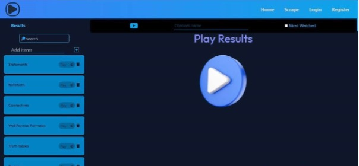
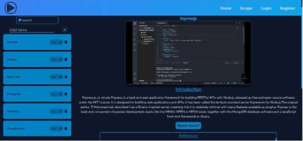

# CogniFetch

**Turn a photo of your syllabus into a curated study plan.** Upload an image, and CogniFetch reads the text (OCR),
extracts every topic with Gemini, then finds a focused YouTube video and a short Wikipedia explainer for each one.
Save subjects to your profile and come back to them any time.

| Home | Scan | Results | Topic |
| --- | --- | --- | --- |
|  |  |  |  |

## Architecture

```
client/   React 19 + Vite + Tailwind 4 SPA
server/   Express 5 REST API + MongoDB (Mongoose)
            ├─ OCR.space      image → text
            ├─ Gemini         text → topics (falls back to a rule-based extractor)
            ├─ YouTube Data   topic → video
            └─ Wikipedia      topic → summary
```

In production a single container serves both the API (`/api/*`) and the built client, so the session cookie is
first-party and no CORS setup is needed. Split deployments (separate frontend host) are also supported.

### Production features

- **Auth**: bcrypt (12 rounds) password hashing, JWT in an `HttpOnly`/`SameSite` cookie, case-insensitive unique
  usernames, constant-time login responses, account deletion that removes all user data.
- **Hardening**: Helmet with a strict Content-Security-Policy, origin allowlist (also blocks cross-site requests),
  per-route rate limits (auth, OCR, video search), request size limits, upload type checks by magic bytes rather than
  the file name, Zod validation on every input, and log redaction for secrets and cookies.
- **Reliability**: validated config that fails fast, timeouts on every outbound call, graceful shutdown, a
  `/api/health` endpoint, in-memory caching of YouTube and Wikipedia lookups to save API quota, and a structured
  JSON error format.
- **Quality**: 55+ automated tests (unit, API, React components, and MongoDB integration tests in CI), ESLint, a
  GitHub Actions CI pipeline and a multi-stage Docker image that runs as a non-root user.

## Quick start

Requirements: Node.js 20.19+ (22 recommended) and MongoDB (local, Docker or Atlas).

```bash
git clone https://github.com/rahuljuluru92/CogniFetch-Information_Retrieval_System.git
cd CogniFetch-Information_Retrieval_System
npm install
cp server/.env.example server/.env   # then fill in the values
npm run dev                          # API on :3500, web app on http://localhost:5173
```

The Vite dev server proxies `/api` to the API, so everything runs on one origin locally.

### API keys

| Variable | Needed for | Get one |
| --- | --- | --- |
| `OCR_API_KEY` | Reading images (required) | <https://ocr.space/ocrapi> |
| `YOUTUBE_API_KEY` | Video search (required) | Google Cloud Console → enable **YouTube Data API v3** |
| `GEMINI_API_KEY` | Smarter topic extraction (optional) | <https://aistudio.google.com/app/apikey> |
| `JWT_SECRET` | Signing sessions (required, 32+ chars) | `node -e "console.log(require('crypto').randomBytes(48).toString('base64url'))"` |

See [`server/.env.example`](server/.env.example) for every option.

## Scripts

| Command | What it does |
| --- | --- |
| `npm run dev` | API (auto-reload) and client together |
| `npm test` | All server and client tests |
| `npm run lint` | ESLint for both workspaces |
| `npm run build` | Production build of the client into `client/dist` |
| `npm start` | Start the API (set `SERVE_CLIENT=true` to also serve `client/dist`) |

Database integration tests run when `MONGODB_TEST_URI` is set (CI starts a MongoDB service for them):

```bash
MONGODB_TEST_URI=mongodb://127.0.0.1:27017/cognifetch-test npm test --workspace server
```

## Deployment

### Docker (recommended)

```bash
docker compose up --build
```

This starts the app and MongoDB at <http://localhost:3500> using `server/.env` for secrets. For a hosted deployment
(Render, Railway, Fly.io, ECS…), build the `Dockerfile` and set at least `MONGODB_URI`, `JWT_SECRET`,
`OCR_API_KEY`, `YOUTUBE_API_KEY` and, behind a load balancer, `TRUST_PROXY=1`. Serve it over HTTPS.

### Separate frontend host

Build the client with `VITE_API_URL=https://your-api.example.com`, and set the following on the API:
`CORS_ORIGINS=https://your-frontend.example.com`, `COOKIE_SAMESITE=none` (this makes the cookie `Secure`) and
`SERVE_CLIENT=false`.

## API

All endpoints are under `/api`. Errors use the shape `{ "error": { "code", "message", "details?" } }`.

| Method | Path | Auth | Description |
| --- | --- | --- | --- |
| GET | `/health` | – | Liveness and database status |
| POST | `/auth/register` | – | `{ username, email, password }` → creates an account and starts a session |
| POST | `/auth/login` | – | `{ email, password }` → starts a session |
| POST | `/auth/logout` | – | Ends the session |
| GET | `/auth/me` | ✓ | Current user |
| DELETE | `/auth/me` | ✓ | `{ password }` → deletes the account and all its data |
| POST | `/extract` | ✓ | multipart `image` (JPEG/PNG/WebP) → `{ concepts: string[], source }` |
| POST | `/videos/search` | ✓ | `{ concept, subject?, channel?, popular? }` → `{ video, article }` |
| GET | `/history` | ✓ | Saved subjects |
| PUT | `/history` | ✓ | `{ subject, concepts[] }` → saves or replaces the subject |
| DELETE | `/history/:id` | ✓ | Removes a saved subject |

## Security

Never commit `.env` files; they are git-ignored. If a secret was ever pushed, **rotate it**: deleting it in a new
commit does not remove it from git history.

## Roadmap

- Topic recommendations based on frequent searches
- Progress tracking per subject
- Merging videos into playlists to cut playback time

## Authors

- **Rahul Juluru**: [@rahuljuluru92](https://github.com/rahuljuluru92)
- **Kamal Poshala**: [@Kamal-Poshala](https://github.com/Kamal-Poshala)
