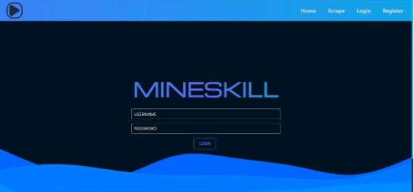
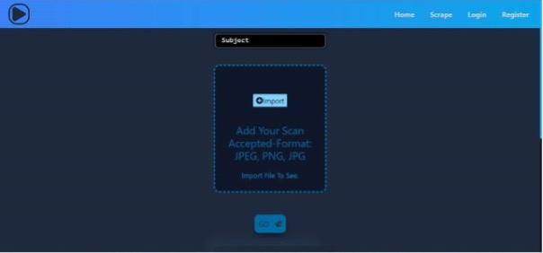

# CogniFetch: Enhancing Student Learning Through Intelligent Information Retrieval

## Project Overview

CogniFetch is a web application designed to enhance student learning by leveraging intelligent information retrieval. The application allows users to upload images of text, which are then processed using Optical Character Recognition (OCR) and natural language processing (NLP) technologies to fetch relevant educational content from the web.

## Screenshots

### Home Page
  
*Figure 6.1: Home Page*

### Scrape Page
  
*Figure 6.2: Scrape Page*

### Results Page
  
*Figure 6.3: Results Page*

### Individual Result
  
*Figure 6.4: Individual Subpart Result*

## Installation

To set up the project, follow these steps:

1. **Clone the repository**:
    ```bash
    git clone https://github.com/rahuljuluru92/yt798.git
    ```

2. **Install dependencies**:
    - For the backend (Node.js):
    ```bash
    npm install
    ```

    - For the frontend (React):
    ```bash
    npm install
    ```

## Run the Application

To start the application locally, follow these steps:

- **Backend**:
    ```bash
    npm start
    ```

- **Frontend**:
    ```bash
    npm run dev
    ```

## Conclusion

CogniFetch is designed to reduce the time students spend searching for educational content and organize relevant resources effectively. It enhances the learning experience by leveraging multiple APIs and providing an intuitive interface.

## Future Enhancements

- Integration of subject/concept recommendation system based on frequent searches.
- User progress tracking in different subjects.
- Merging of playlists to reduce video playback time.

## Authors

- **Kamal Poshala** - Co-author and collaborator.  
  GitHub: [Kamal Poshala](https://github.com/Kamal-Poshala)

- **Rahul Juluru** - Co-author and collaborator.  
  GitHub: [Rahul Juluru](https://github.com/rahuljuluru92)
